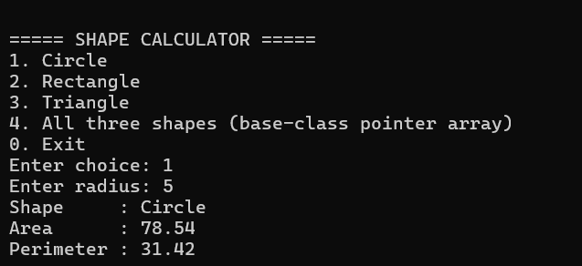
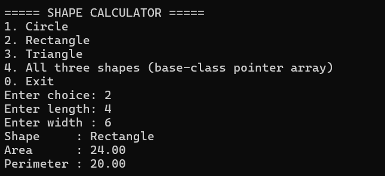
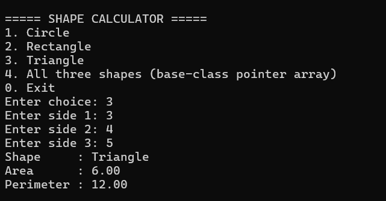
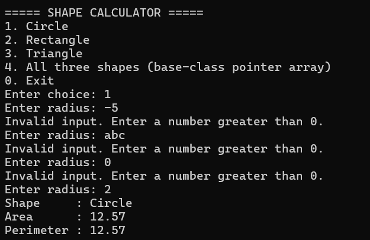
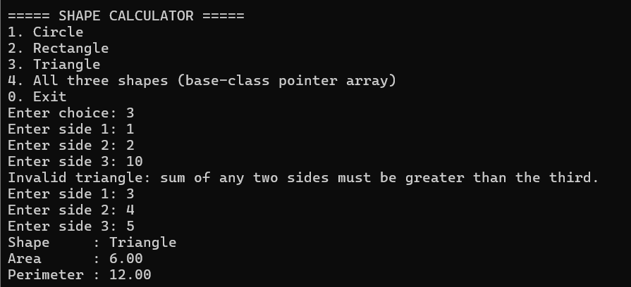
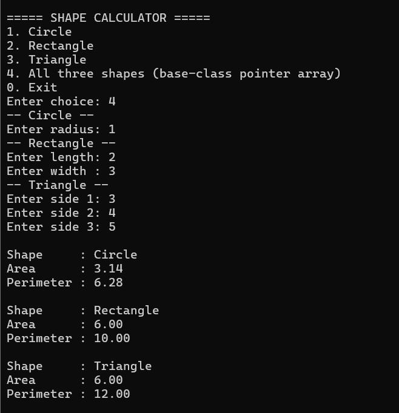
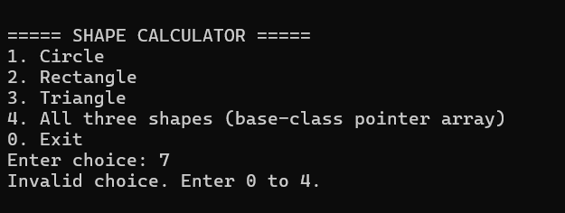

# Shape Area & Perimeter Calculator (C++)

OOPS Mini Project (PPF)

## Features
- Circle, Rectangle and Triangle area and perimeter
- Abstract base class Shape with virtual functions
- Runtime polymorphism using base-class pointers
- Input validation (positive numbers, valid triangle, menu choice)

## OOPS Concepts
Classes and objects, encapsulation, constructors, inheritance,
virtual functions, function overriding, runtime polymorphism

## How to Compile and Run
Dev-C++: open shape.cpp and press F11
Command line:
g++ shape.cpp -o shape
./shape

## Screenshots

## Report
See report/Project_Report.pdf

## Author
Jalkiran Kaur | Roll No.: 2556582 | B.Tech (AI&DS)